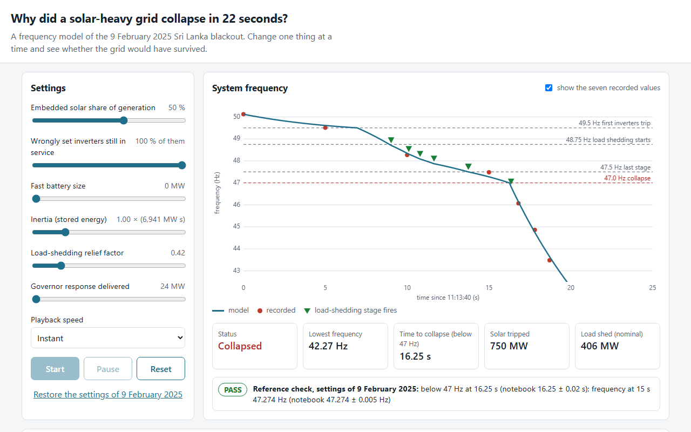
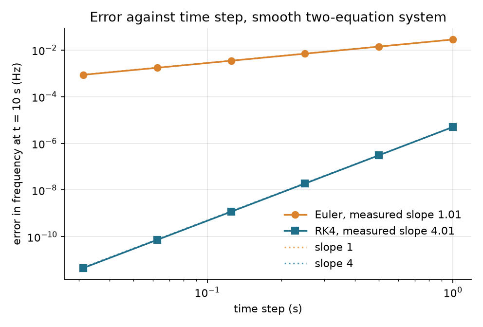

# [Project Title]

[One-sentence pitch: what this simulation does and the question it answers.]

**[Live demo](https://[your-github-user].github.io/[repository-name]/)** · [](https://colab.research.google.com/github/[your-github-user]/[repository-name]/blob/main/notebook/project-name.ipynb)



## The problem

[The real-world situation, the specific question this simulation answers, and why it matters. Plain English, 1–2 short paragraphs.]

## Quick start

**Notebook:** click the *Open in Colab* badge above, then *Runtime → Run all*. Everything installs and runs in about [N] minutes on a free runtime.

**Web demo:** open the [live demo](https://[your-github-user].github.io/[repository-name]/), or download this repository and double-click `docs/index.html`.

**Run locally (optional):**

```bash
pip install -r requirements.txt
jupyter notebook notebook/project-name.ipynb
```

## Using the demo

[Two or three sentences on the main controls and outputs.] Full guide: [USER_GUIDE.md](USER_GUIDE.md).

## Model and mathematics

[Short summary of the model with its key equation(s), e.g. $\frac{dx}{dt} = f(x, t)$, and the numerical method.] Full derivations, assumptions and parameters: [THEORY.md](THEORY.md).

## Verification

[How you know the numbers are right: the check(s) you ran and the result, e.g. "the simulated mean wait matches the analytic M/M/1 value to within 2%".]



## Concepts applied

[Name the modelling and numerical concepts this project applies and how each is used. Generic wording only. Example: "This project applies next-event time-advance discrete-event simulation, inverse-transform random variate generation and Monte Carlo confidence intervals based on the law of large numbers, and verifies the simulator against analytic steady-state results."]

## Results

[The answer to the question, with the key figure or table.]

## Limitations and future work

- [Most important assumption and how it limits the result]
- [What you would add with more time or data]

## Key references

1. [Author, "Title," *Venue*, year. DOI/URL]
2. [...]

Full list: [REFERENCES.md](REFERENCES.md).

## AI assistance

Developed with the help of AI coding and writing assistants. All code was reviewed, run and verified by the author.

## Licence and credits

Code: [MIT](LICENSE). Data: [source, licence, e.g. "Weather data: Open-Meteo, CC BY 4.0"].
