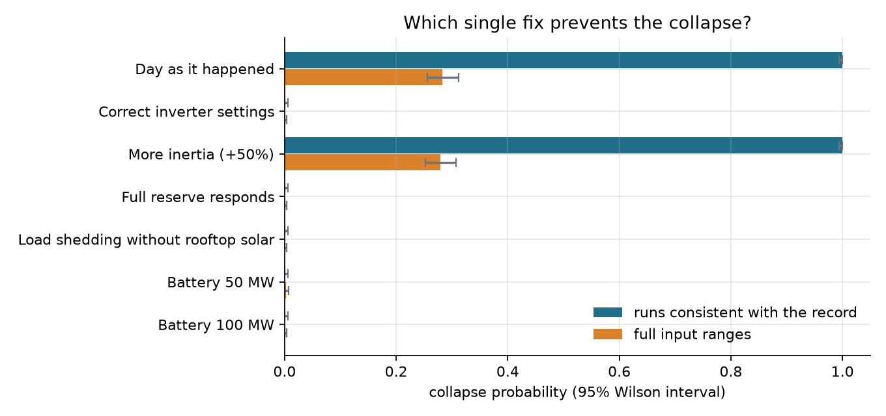
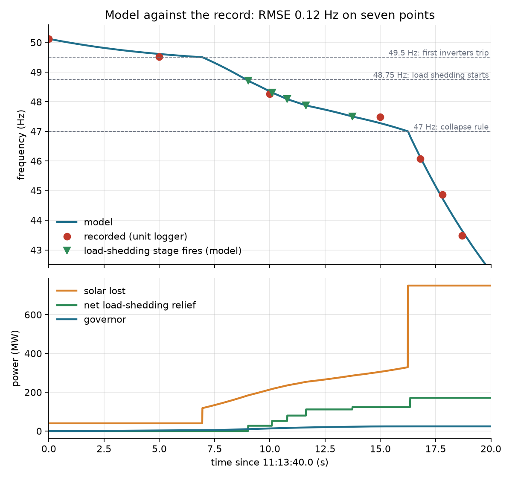

# Why Did Sri Lanka's Solar-Heavy Grid Collapse in 2025, and What Would Prevent It?

A small, verified model of the grid frequency during the 9 February 2025 island-wide blackout, used to test which single fix would have kept the lights on.

**[Live demo](https://vinuki-thiranya.github.io/Power-System-Frequency-Stability/)** · [](https://colab.research.google.com/github/vinuki-thiranya/Power-System-Frequency-Stability/blob/main/notebook/Power-System-Frequency-Stability.ipynb)


## The problem

At 11:13 on Sunday 9 February 2025 a monkey touched a 33 kV busbar at the Panadura grid substation. Protection cleared the fault in about one second and no large power station failed. Even so, the system frequency slid from 50.12 Hz to 43.5 Hz in under 19 seconds and the whole island lost power for about four and a half hours.

About half of the generation at that moment was rooftop solar. The published investigations blame several weaknesses and weigh them differently: rooftop inverters set to disconnect too early, a load-shedding scheme that switched off feeders carrying their own solar, a slow generator response, and low inertia.

**Question:** which of these mattered most, and which single fix would have prevented the collapse?

## Quick start

**Notebook:** click the *Open in Colab* badge above, then *Runtime → Run all*. Nothing needs installing, and it finishes in a few minutes on a free runtime (about 3 minutes of processor time on a laptop).

**Web demo:** open the [live demo](https://vinuki-thiranya.github.io/Power-System-Frequency-Stability/), or download this repository and double-click `docs/index.html`. It needs no internet connection.

**Run locally (optional):**

```bash
pip install -r requirements.txt
jupyter notebook notebook/Power-System-Frequency-Stability.ipynb
```

## Using the demo

Press **Start** to replay the event with the settings of the day. Then press **Reset**, move one slider (inverter settings, battery size, inertia, load-shedding relief, governor response or solar share) and press **Start** again to see whether the grid survives. The page shows the lowest frequency, the time of collapse, the solar tripped and the load shed, and it checks itself against two numbers from the notebook. Full guide: [USER_GUIDE.md](USER_GUIDE.md).

## Model and mathematics

The whole island is treated as one frequency $f$. Two ordinary differential equations are solved with a fourth-order Runge-Kutta method in 10 ms steps:

$$\frac{df}{dt} = \frac{f_0}{2E_k}\Big(u(t) + P_g + P_b - D\,(f - f_{init})\Big), \qquad \frac{dP_g}{dt} = \frac{1}{T_g}\Big(\min\big(P_{cap},\, K\max(f_0 - f, 0)\big) - P_g\Big)$$

$E_k$ is the kinetic energy stored in the spinning machines, $D$ the load damping, $P_g$ the governor response and $P_b$ an optional battery. The net power change $u(t)$ comes from threshold rules applied between steps: a first solar loss caused by the voltage dip, inverters disconnecting by frequency band, and the load-shedding stages with their time delays. Full equations, assumptions and parameters: [THEORY.md](THEORY.md).

## Verification

| Check | Result |
|---|---|
| Exact solution (governor off) | largest RK4 error 7 × 10⁻¹⁴ Hz |
| Limiting cases (no loss; no damping; first-step slope) | exact to rounding |
| Error order on the smooth problem | RK4 4.01, Euler 1.01 |
| Energy balance, all events on | relative residual 3 × 10⁻⁷ |
| Monte Carlo error against number of runs | slope close to −1/2 |
| Fit to the seven recorded frequency values | RMSE 0.12 Hz |


## Concepts applied

This project applies numerical solution of ordinary differential equations with the explicit Euler and classical fourth-order Runge-Kutta methods, including a measured order-of-accuracy study; input modelling of uncertain parameters and inverse-transform random variate generation from an empirical distribution; and Monte Carlo estimation with confidence intervals based on the law of large numbers, with the $N^{-1/2}$ error scaling measured. It also uses acceptance-rejection sampling to keep only the simulated cases that match recorded data, bisection to size a remedy, and verification against an analytic solution, limiting cases and an energy-conservation check.

## Results

For the simulated cases that reproduce the recorded frequency (601 of 40,000 Monte Carlo runs):

| Change | Collapse probability (95% interval) |
|---|---|
| Day as it happened | 100% (99.4 to 100%) |
| Correct inverter settings (all at 47 Hz) | 0% (0 to 0.6%) |
| 50% more inertia | 100% (99.4 to 100%), about 9 s later |
| Full 230 MW spinning reserve responds | 0% (0 to 0.6%) |
| Load shedding that removes no rooftop solar | 0% (0 to 0.6%) |
| Fast battery, 50 MW | 0% (0 to 0.6%) |



- The collapse was a **power-balance** failure. Inertia only sets how fast the frequency falls, so more of it delays the collapse without preventing it.
- The grid was close to balance: resetting about 30% of the wrongly set inverters, a battery of about 36 MW, or about 96 MW of governor response (24 MW was delivered) would each have been enough.
- Across the full ranges of the uncertain inputs, the weak relief from load shedding is the input that changes the outcome most.
- With the surveyed inverter settings the model stays safe only up to an embedded solar share of about 40%; with every inverter set to 47 Hz it stays safe up to the 70% tested.



## Limitations and future work

- One frequency for the whole island: no voltage and no network. The first solar loss was caused by a voltage dip and is put in by hand.
- Megawatts are assumed to follow the share of surveyed inverters, and the rooftop solar on shed feeders is lumped into one relief factor. Seven data points cannot separate these two effects.
- The model is not expected to be exact below about 46 Hz, where generator protection takes over.
- It cannot settle who was responsible; it only shows which changes alter the outcome under its assumptions.
- Next: use the full recorder trace, weight inverter settings by capacity, and model each load-shedding stage with the rooftop capacity on its own feeders.

## Key references

1. N. S. Wettasinghe, "Analysis of power system failure occurred on 09 February 2025 in Sri Lanka's power system," *Engineer: J. Inst. Eng. Sri Lanka*, vol. 59, no. 1, pp. 145-155, 2026, doi: [10.4038/engineer.v59i1.7740](https://doi.org/10.4038/engineer.v59i1.7740).
2. Public Utilities Commission of Sri Lanka, "Report of the public hearing held on 05th August 2025 at BMICH, on the total system failure occurred on 09th February 2025," 2026.
3. Ceylon Electricity Board, "Report of the committee to investigate the total power system failure occurred on 09-02-2025 at 11:14 hrs," Apr. 2025.
4. P. M. Anderson and M. Mirheydar, "A low-order system frequency response model," *IEEE Trans. Power Syst.*, vol. 5, no. 3, pp. 720-729, 1990, doi: [10.1109/59.65898](https://doi.org/10.1109/59.65898).
5. C. MacIver, K. Bell, and M. Nedd, "An analysis of the August 9th 2019 GB transmission system frequency incident," *Electr. Power Syst. Res.*, vol. 199, 107444, 2021, doi: [10.1016/j.epsr.2021.107444](https://doi.org/10.1016/j.epsr.2021.107444).

Full list: [REFERENCES.md](REFERENCES.md).

## AI assistance

Developed with the help of AI coding and writing assistants. All code was reviewed, run and verified by the author, and every reference was opened and checked.

## Licence and credits

Code: [MIT](LICENSE). Data: figures quoted from Wettasinghe (2026, CC BY-ND 4.0) and from public reports of the Public Utilities Commission of Sri Lanka and the Ceylon Electricity Board; details in [data/README.md](data/README.md).
