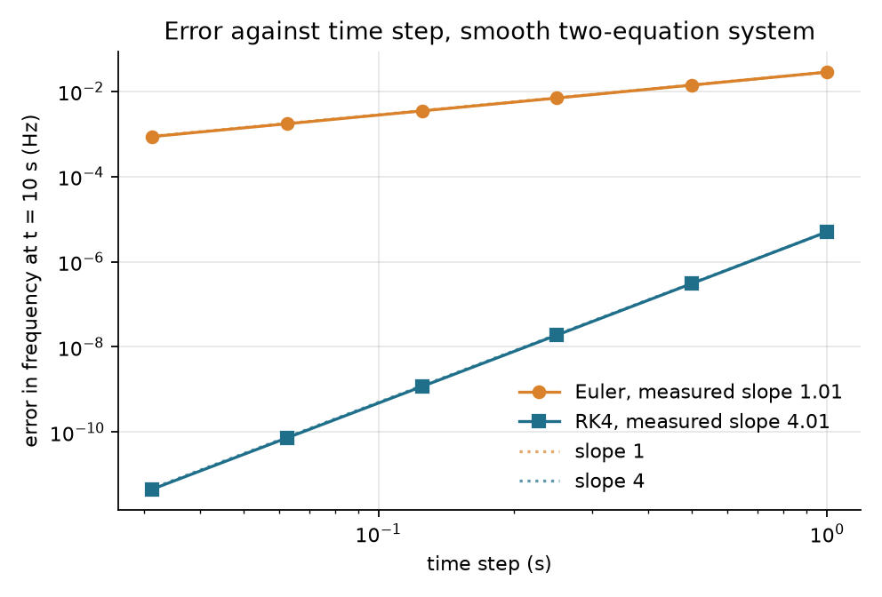
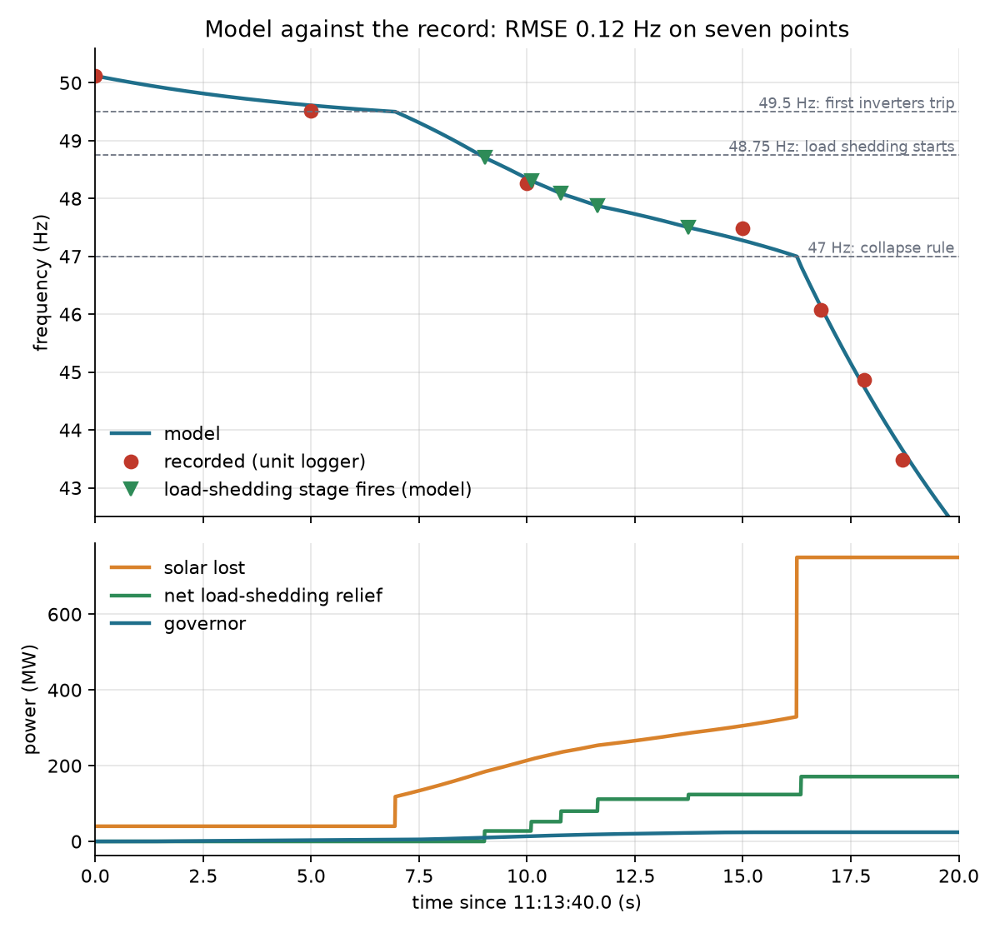

# Theory and mathematics

## 1. Problem formulation

On 9 February 2025 the Sri Lankan grid lost a small amount of rooftop solar generation during a one-second fault, and 22 seconds later the whole system had collapsed. The model follows the **system frequency** $f(t)$ during those seconds. Frequency is the natural quantity to follow because it measures the balance of power: it falls while generation is less than load, and protection devices (rooftop inverters, load-shedding relays, generator protection) all act on it.

**Question:** which factor mattered most (inverter settings, load shedding, generator response, inertia), and which single fix would have prevented the collapse?

**Quantities of interest:** whether the frequency falls below 47.0 Hz (collapse), when, the lowest frequency reached if it does not, and the probability of collapse when the uncertain inputs are varied.

## 2. Assumptions

1. **One frequency for the whole island** (a single-bus model). Reasonable for a compact island system and standard for this kind of study; voltage and network flows are not modelled.
2. **The first solar loss is injected, not simulated.** It was caused by a voltage dip, which a frequency-only model cannot produce. Its size is treated as uncertain between the two published figures (25 and 77 MW).
3. **Megawatts follow inverter counts.** The share of rooftop megawatts at each trip setting equals the share of surveyed inverters at that setting.
4. **Inverters trip as soon as their setting is reached** and stay off for the window simulated.
5. **Load damping is linear** in frequency and does not shrink as load is shed.
6. **Each shed block gives only a fraction $r$ of its nominal megawatts as relief**, because the feeder's rooftop solar is disconnected with it.
7. **The governor is a first-order lag with a limit**, fitted to the one unit whose output is published.
8. **The model stops being reliable below about 46 Hz**, where generator protection takes over.

## 3. Model equations

State: frequency $f$ (Hz), governor power $P_g$ (MW), battery power $P_b$ (MW). Time $t$ is in seconds from 11:13:40.0.

**Swing equation.** The rate of change of frequency is the power imbalance divided by the inertia of the spinning machines.

$$\frac{df}{dt} = \frac{f_0}{2E_k}\Big(u(t) + P_g + P_b - D\,(f - f_{init})\Big)$$

**Governor.** Droop response with a lag and an upper limit.

$$\frac{dP_g}{dt} = \frac{1}{T_g}\Big(\min\big(P_{cap},\; K\,\max(f_0 - f,\,0)\big) - P_g\Big)$$

**Battery (optional).** Droop that reaches full power $\Delta f_b$ below $f_b$, followed with a response time $\tau_b$.

$$\frac{dP_b}{dt} = \frac{1}{\tau_b}\Big(\mathrm{clip}\big(\tfrac{P_{bat}}{\Delta f_b}(f_b - f),\,0,\,P_{bat}\big) - P_b\Big)$$

**Net power change from the event rules.**

$$u(t) = -\Delta P_0 \;-\; (P_{emb} - \Delta P_0)\,F(f_{min}) \;+\; r \sum_{i \in \text{fired}} L_i$$

- $\Delta P_0$: first solar loss, present from $t = 0$.
- $F(f_{min})$: share of the remaining embedded pool that has tripped once the frequency has been as low as $f_{min}$: 11.0% at 49.5 Hz, a further 17.5% spread evenly between 49.5 and 48 Hz, a further 12.2% spread between 48 and 47 Hz, and everything at 47 Hz.
- $L_i$: megawatts of load-shedding stage $i$, which fires once its condition has held for its delay.

| Stage | Condition | Delay | Load $L_i$ (MW) |
|---|---|---|---|
| I | $f \le 48.75$ Hz | 100 ms | 65.4 |
| II | $f \le 48.50$ Hz | 500 ms | 58.5 |
| III | $f \le 48.25$ Hz | 500 ms | 65.7 |
| IV | $f \le 48.00$ Hz | 500 ms | 75.2 |
| V | $f \le 47.5$ Hz | none | 5.8 |
| V or df/dt | $f \le 47.5$ Hz, or $f < 49$ Hz with $df/dt < -0.85$ Hz/s for 100 ms | none / 100 ms | 23.2 |
| df/dt | $f < 49$ Hz with $df/dt < -0.85$ Hz/s for 100 ms | 100 ms | 112.3 |

| Symbol | Meaning | Units | Value / range | Source |
|---|---|---|---|---|
| $f_0$ | nominal frequency | Hz | 50 | system standard |
| $f_{init}$ | frequency at $t = 0$ | Hz | 50.12 | [1] Table 8 |
| $E_k$ | stored kinetic energy | MW s | 6,941 (calibrated); 5,290 to 9,000 sampled | floor from unit data in [3] |
| $D$ | load damping | MW/Hz | 36.1 (calibrated); 30 to 60 sampled | 1 to 2% per 1% on 1,489 MW |
| $K$ | governor gain | MW/Hz | 9.4 (fitted) | unit record, [1] Table 8 |
| $T_g$ | governor lag | s | 0.55 (fitted) | same |
| $P_{cap}$ | governor limit | MW | 24.3 (fitted); ±20% sampled | same |
| $\Delta P_0$ | first solar loss | MW | 40.1 (calibrated); 25 to 77 sampled | [1], [2] |
| $P_{emb}$ | embedded generation | MW | 750 | 1,489 − 739, [1] |
| $r$ | relief factor | – | 0.42 (calibrated); 0.3 to 1.0 sampled | [1] reports about 0.5 |
| $P_{bat}$, $\tau_b$ | battery size, response time | MW, s | 0 to 150; 0.1 to 0.5 | [7], [10] of the notebook |

Reference numbers are those of the notebook's reference list; full details are in [REFERENCES.md](REFERENCES.md).

## 4. Numerical method

**Time stepping.** The three equations are advanced with the classical fourth-order Runge-Kutta method (RK4) at a fixed step $\Delta t = 10$ ms, with $u$ held constant during each step. Explicit Euler is implemented as well, for comparison.

**Accuracy.** For a smooth problem the global error of RK4 is $O(\Delta t^4)$ and that of Euler is $O(\Delta t)$. This is measured in the notebook (slopes 4.01 and 1.01).

**Stability.** For a linear decay with time constant $\tau$, RK4 is stable for $\Delta t < 2.79\,\tau$. The fastest time constant in the model is the battery response ($\tau_b \ge 0.1$ s) or the governor lag (0.55 s), so the step of 0.01 s is at least 27 times inside the limit.

**Events.** Thresholds are tested at the start of each step. An event can therefore be noticed up to one step late, which makes the full model first-order accurate in time, not fourth-order. The step of 10 ms divides the relay delays (100 ms and 500 ms) exactly, and the measured error at this step is 0.002 Hz against a run ten times finer.

**Monte Carlo.** Uncertain inputs are sampled with one seeded generator and all runs are advanced together as arrays. The collapse probability is the mean of 0/1 outcomes; its standard error falls as $N^{-1/2}$ (measured slope −0.53). Intervals are 95% Wilson score intervals, which stay valid at probabilities of 0 and 1:

$$\frac{\hat{p} + \dfrac{z^2}{2N}}{1 + \dfrac{z^2}{N}} \;\pm\; \frac{z}{1 + \dfrac{z^2}{N}}\sqrt{\frac{\hat{p}(1-\hat{p})}{N} + \frac{z^2}{4N^2}}, \qquad z = 1.96$$

**Inverse-transform sampling.** The inverter survey (1,608 inverters) is a sample, so each run redraws 1,608 settings by passing uniform random numbers through the inverse of the empirical cumulative distribution of the four settings.

**Acceptance-rejection.** To test remedies on cases that behave like the real day, only the runs whose simulated frequency is within 0.5 Hz (root mean square) of the seven recorded values are kept.

**Deciding survival.** A run survives only if its frequency has stopped falling above 47 Hz. Runs still falling at 20 s are followed to 60 s and, if needed, 300 s.

## 5. Verification

| Check | Expected | Obtained | Pass? |
|---|---|---|---|
| Exact solution, governor off: $f(t) = f_{init} - \frac{\Delta P}{D}(1 - e^{-t/\tau})$, $\tau = \frac{2E_k}{f_0 D}$ | error below $10^{-9}$ Hz | $7 \times 10^{-14}$ Hz | yes |
| No loss | frequency does not move | drift exactly 0 | yes |
| First-step slope $-\frac{f_0 \Delta P}{2E_k}$ | −0.208333 Hz/s | −0.208333 Hz/s | yes |
| No damping, no governor | straight line | error $2 \times 10^{-12}$ Hz | yes |
| Error order, smooth two-equation system against the matrix-exponential solution | RK4 4, Euler 1 | 4.01, 1.01 | yes |
| Energy balance $\int (u + P_g + P_b - D(f - f_{init}))\,dt = \frac{2E_k}{f_0}(f(T) - f(0))$, all events on | residual below $10^{-4}$ | $3 \times 10^{-7}$ | yes |
| Full event model against a run ten times finer | error below 0.02 Hz at 10 ms | 0.002 Hz | yes |
| Wilson interval for 0 of 10 | [0, 0.2775] | [0, 0.2775] | yes |
| Inverse-transform sampler: mean and spread of redrawn shares | survey shares; binomial spread | within 1% | yes |
| Monte Carlo error against $N$ | slope −0.5 | −0.53 | yes |
| Battery known answer: $f_{ss} = \frac{K_b f_b + D f_{init} - \Delta P}{K_b + D}$ | 49.668900 Hz | 49.668900 Hz | yes |
| Web demo against the notebook (default settings) | 16.25 s; 47.274 Hz | 16.25 s; 47.274 Hz | yes |

**Validation against the real event** (separate from verification):

| Quantity | Recorded | Model |
|---|---|---|
| Seven frequency values, 0 to 18.7 s | 50.12, 49.51, 48.27, 47.48, 46.07, 44.86, 43.48 Hz | 50.12, 49.61, 48.35, 47.27, 46.14, 44.75, 43.65 Hz (RMSE 0.12 Hz) |
| Frequency reaches 49.5 Hz | 4.98 s | 6.95 s |
| Load-shedding stages I to V fire | 8.33, 8.83, 9.38, 10.13, 14.43 s | 9.02, 10.10, 10.79, 11.64, 13.74 s |
| Rate of fall from 47.5 Hz | 1.3 Hz/s | 0.8 Hz/s |
| Stored energy | at least 5,290 MW s from the machines known to be running | 6,941 MW s |

The event times come from a different instrument from the one used in the fit; the two disagree by up to about 0.6 s.

## 6. Concepts applied

| Concept | Where it is used in this project |
|---|---|
| Numerical solution of ordinary differential equations (explicit Euler, fourth-order Runge-Kutta) | `rhs`, `step_euler`, `step_rk4`; notebook sections 4.2 and 4.3 |
| Order of accuracy and stability of a time-stepper | measured error-order plot, notebook section 5 (checks 3 and 5) |
| Verification against analytic solutions, limiting cases and a conservation law | notebook section 5 (checks 1, 2 and 4) |
| Input modelling: choosing distributions for uncertain inputs | notebook section 6.2 |
| Random variate generation by inverse-transform sampling from an empirical distribution | `sample_inverter_shares`, notebook sections 4.4 and 6.2 |
| Monte Carlo estimation, the law of large numbers and $N^{-1/2}$ error scaling | notebook sections 6.2 and 6.3 |
| Confidence intervals for a proportion (Wilson score interval) | every probability reported in section 6 |
| Acceptance-rejection sampling | notebook section 6.5 |
| Sensitivity analysis | notebook section 6.4 |
| Root finding by bisection | battery and remedy sizing, notebook section 6.8 |
| Model calibration and validation against recorded data | notebook section 6.1 |

## 7. References

See [REFERENCES.md](REFERENCES.md).
