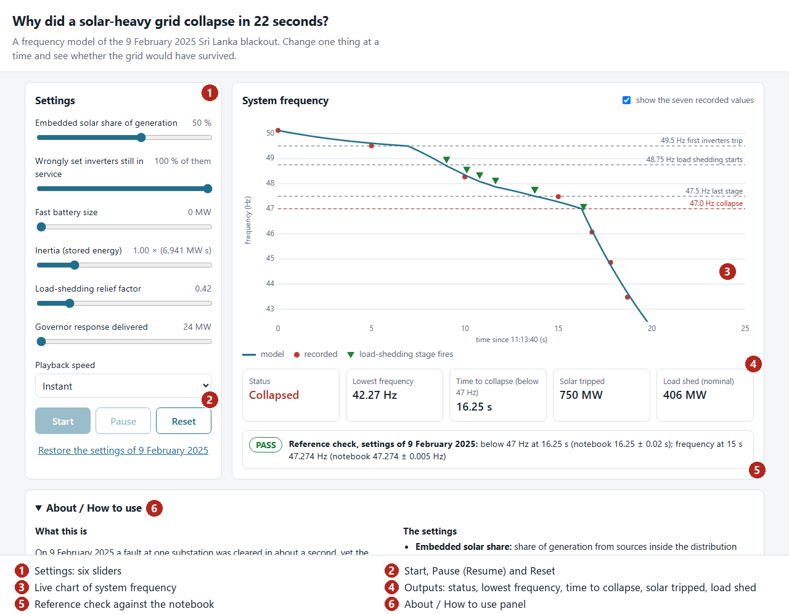

# User guide: grid frequency collapse simulator

**Open the demo:** https://vinuki-thiranya.github.io/Power-System-Frequency-Stability/ or download the repository and double-click `docs/index.html`. It runs entirely in your browser (current Chrome, Edge or Firefox). Nothing is installed or uploaded, and no internet connection is needed once the page has loaded.

## Controls

| Control | What it does | Range | Default (the day) |
|---|---|---|---|
| Embedded solar share of generation | Share of generation from sources inside the distribution network, mostly rooftop solar. More solar means fewer spinning machines (less stored energy), a larger first loss, and more solar on each shed feeder. | 20 to 70% | 50% |
| Wrongly set inverters still in service | 41% of surveyed inverters were set to disconnect above the prescribed 47 Hz. 100% keeps them as surveyed; 0% means every inverter waits until 47 Hz. | 0 to 100% of them | 100% |
| Fast battery size | A battery that starts to respond below 49.8 Hz, reaches full power at 49.5 Hz, and responds in 0.25 s. | 0 to 150 MW | 0 MW |
| Inertia (stored energy) | Multiplies the kinetic energy stored in the spinning machines. | 0.5 to 3 times | 1.00 (6,941 MW s) |
| Load-shedding relief factor | Share of each shed block that is real relief. It is below 1 because shed feeders also carry rooftop solar. | 0.3 to 1.0 | 0.42 |
| Governor response delivered | Extra power the generators actually deliver as the frequency falls. 230 MW was held in reserve. | 24 to 230 MW | 24 MW |
| Playback speed | How fast the run is drawn. *Instant* shows the whole run at once. | real time to instant | 3 times faster |
| Start / Pause | Runs or pauses the simulation. After a pause the button reads *Resume*. | | |
| Reset | Clears the run and applies the current settings. Moving any slider also resets. | | |
| Restore the settings of 9 February 2025 | Puts every slider back to its default. | | |

A slider left at its default uses the exact calibrated value from the notebook (for example 50.37% solar, not 50%).

## Reading the outputs

- **Chart:** the blue line is the simulated system frequency in hertz against time in seconds from 11:13:40. The red dots are the seven recorded values. The dashed lines mark 49.5 Hz (the first inverters trip), 48.75 Hz (load shedding starts), 47.5 Hz (last load-shedding stage) and 47.0 Hz (most inverters trip: collapse). A green triangle appears each time a load-shedding stage fires.
- **Status:** *Collapsed* once the frequency is below 47.0 Hz; *Stable at … Hz* when the frequency has stopped falling above 47 Hz; *Still falling* if it has not settled after 60 s (this is not a survival).
- **Lowest frequency (Hz):** the lowest value reached so far. Traces are not followed below 42.5 Hz.
- **Time to collapse (s):** when the frequency first fell below 47.0 Hz, or *Survived*.
- **Solar tripped (MW):** embedded generation disconnected so far.
- **Load shed, nominal (MW):** megawatts switched off by the load-shedding scheme. The real relief is this number times the relief factor.
- **Reference check:** each time the page loads, it reruns the default settings and compares two numbers with the notebook. It should read PASS.

The model has no random element in the demo, so a given set of slider values always gives the same run. The notebook adds the uncertainty study.

## Try this

1. Press **Start** with the default settings. The frequency passes through the recorded points and falls below 47 Hz at 16.25 s.
2. **Reset**, set *wrongly set inverters* to **0%**, and press **Start**. The frequency settles near 49.2 Hz and no load is shed. Now try 70%: the grid still survives.
3. **Reset**, restore the defaults, set the *battery* to **40 MW**. The battery holds the frequency above 49.5 Hz, so the inverter cascade never starts.
4. **Reset**, restore the defaults, set *inertia* to **2.0**. The frequency falls more slowly but still collapses, at about 34 s. Inertia buys time; it does not close the power gap.
5. **Reset**, restore the defaults, set the *solar share* to **40%**. The grid survives, settling near 48.2 Hz after shedding load.

## Check against the notebook

With the default settings, the demo should give **frequency below 47.0 Hz at t = 16.25 s (± 0.02 s)** and **frequency at t = 15 s of 47.274 Hz (± 0.005 Hz)**, matching section 6.10 of the notebook. The page shows this comparison under the chart.

## Sharing a case

Settings can be put in the address, for example
`index.html#wrong=0&autorun` or `index.html#battery=40&inertia=1.5&autorun`.
Slider names: `solar`, `wrong`, `battery`, `inertia`, `relief`, `governor`. Add `theme=light` or `theme=dark` to force a colour scheme.

## Limitations

- One frequency for the whole island: no voltage and no network. The first solar loss was caused by a voltage dip and is put in by hand.
- The demo runs a single case with the calibrated values; it does not show the uncertainty. Use the notebook for probabilities and confidence intervals.
- Results are not reliable below about 46 Hz, where generator protection (not modelled) takes over.
- Settings far from the day's conditions (for example a solar share of 20% or 70%) rest on simple scaling assumptions and are indicative only.
